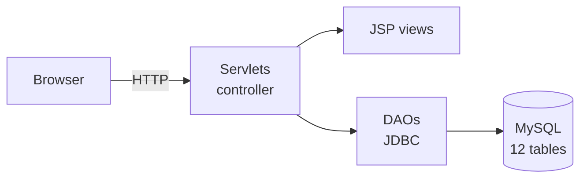
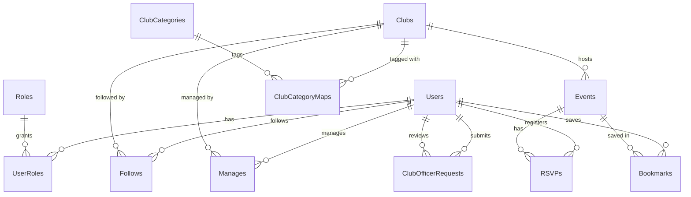

<div align="center">

# SpartanClubConnect

**One place for San José State students to find clubs, follow them and RSVP to events.**

A full-stack Java web app built for CS 157A (Database Management Systems) at San José State University, Mar–May 2026, as a team course project.


</div>

---

## What it does

| Students | Club officers | Admins |
|---|---|---|
| Browse and search clubs by name or category | Create and edit club profiles | Approve or deny officer requests |
| Follow clubs and get a personalized event feed | Publish, edit and remove events | Moderate events |
| Bookmark events | Manage their club's events and RSVPs | Manage users and roles |
| RSVP, join the waitlist, or cancel | | |

Passwords are hashed with BCrypt, forms carry CSRF tokens, output is HTML-escaped, and every page is gated by role-based access control.

## Architecture



A classic MVC layout: servlets handle requests and access checks, DAOs run parameterized JDBC queries, and JSPs render the pages. Packaged as a WAR with Maven and deployed to Tomcat.

## My part

**Database design.** I designed the 12-table MySQL schema and the seed data: users, roles, clubs, categories, events, officer requests, and the relationship tables (user roles, follows, bookmarks, RSVPs, club managers, category mappings) with foreign keys for referential integrity.

**Event booking and RSVP system.** The interesting problem: two students hitting RSVP for the last seat at the same moment. Registration runs as a single transaction:

1. `SELECT ... FROM Events WHERE event_id = ? FOR UPDATE` locks the event row, so concurrent RSVPs for the same event queue up instead of racing.
2. The user's existing RSVP row is locked too, which blocks duplicate registrations.
3. Count current `Going` RSVPs and compare with the event's capacity.
4. Insert as `Going` if there's room, otherwise as `Waitlisted`, then commit. Any failed check rolls back.

```java
String lockEventSql = "SELECT date, end_time, capacity, is_active FROM Events WHERE event_id = ? FOR UPDATE";
...
String targetStatus = (capacity != null && goingCount >= capacity) ? "Waitlisted" : "Going";
```

**Pages.** The servlets and JSP pages for creating events, event details, officer event management and RSVPs.

## Database schema



## Run it locally

**Requirements:** Java 21, Maven, MySQL 8, Tomcat 9 (the app uses the `javax.servlet` API).

```bash
git clone https://github.com/alexxaviers/SpartanClubConnect.git
cd SpartanClubConnect

# create the database and load sample data
mysql -u root -p < src/main/resources/sql/schema.sql
mysql -u root -p < src/main/resources/sql/data.sql

# point the app at your database
cp src/main/resources/db.properties.example src/main/resources/db.properties

mvn package        # builds target/*.war
```

Deploy the WAR to Tomcat and open `http://localhost:8080/`.

## Project structure

```
src/main/java/.../controller/   Servlets (auth, clubs, events, RSVPs, admin)
src/main/java/.../dao/          JDBC data access
src/main/java/.../model/        Domain objects
src/main/java/.../util/         BCrypt hashing, CSRF, HTML escaping, DB connection, pagination
src/main/resources/sql/         Schema, seed data, sample queries
src/main/webapp/                JSP pages and CSS
```

## Team

CS 157A, Section 1, Team 1: Anh Tran, Trista Chen and [Alex Xavier](https://github.com/alexxaviers). Original repository: [ObviousYordle/CS157A-S1-Team-1](https://github.com/ObviousYordle/CS157A-S1-Team-1).
